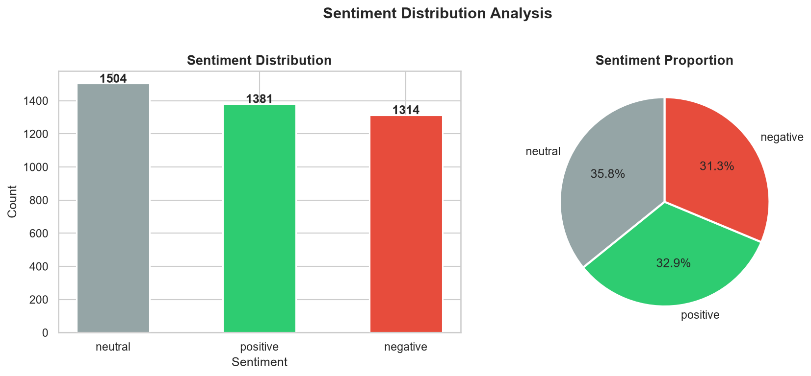
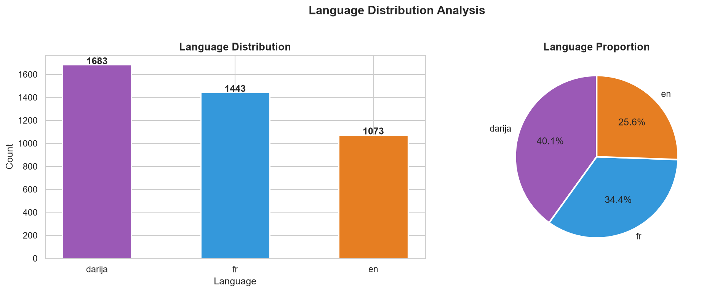
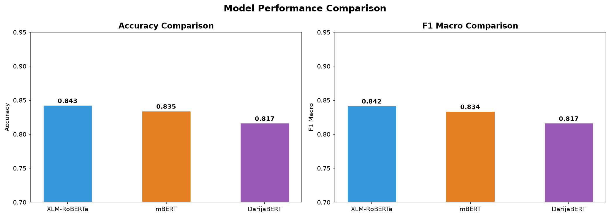
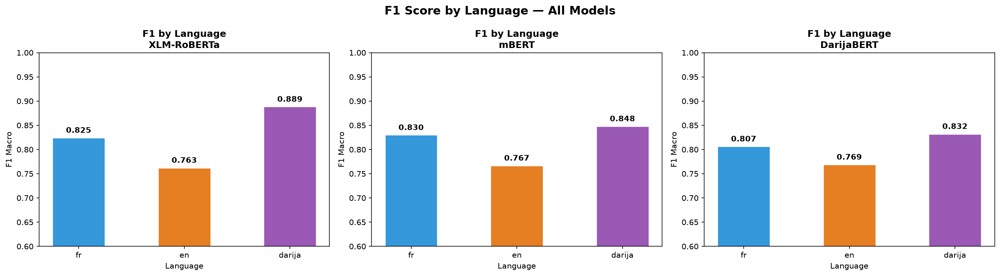
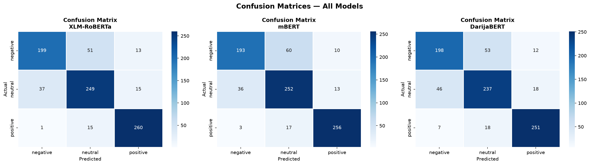
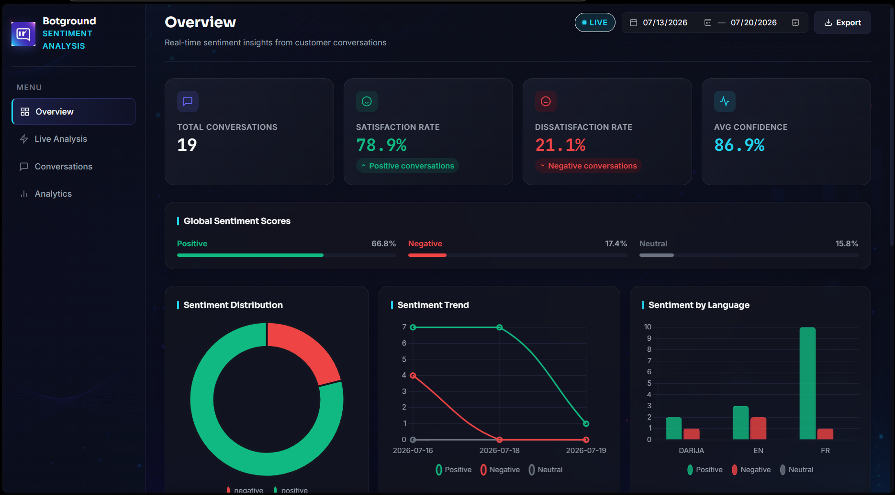
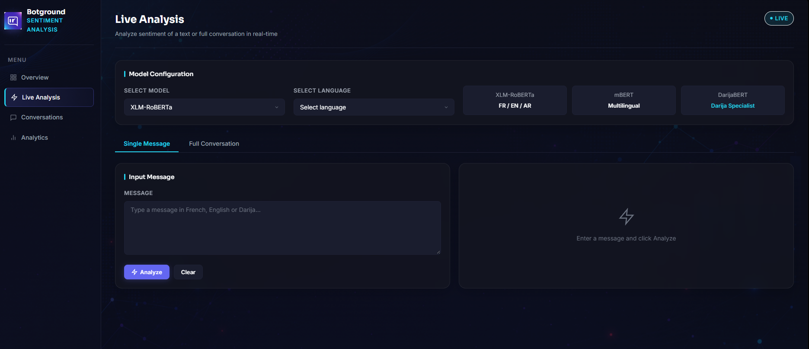

# Botground: Multilingual Sentiment Analysis for Chatbot Conversations

[](#overview)
[](#how-it-works)
[](#the-three-models)
[](#dataset)
[](#results)
[](#dashboard)
[](#quick-start)
[](#limitations)

## Overview

A sentiment analysis system for customer conversations handled by a chatbot, in **French**, **English** and **Moroccan Darija** (written in Latin letters). Three multilingual transformers are fine-tuned and compared, and the best one powers a **Flask dashboard** that scores messages and whole conversations in real time and tracks customer satisfaction.

Developed during an internship, supervised by [Abdelali Chanchaf](https://www.linkedin.com/in/abdelali-chanchaf-ba4499177/). The training data is confidential and is not included (see [data/README.md](data/README.md)).

| | |
|---|---|
| **Task** | 3-class sentiment (negative, neutral, positive) |
| **Languages** | French, English, Darija |
| **Domains** | Customer support, hospitality, logistics |
| **Dataset** | 4,199 labelled user messages |
| **Best model** | XLM-RoBERTa base, 0.842 macro F1 on 840 test messages |
| **Stack** | PyTorch, Hugging Face Transformers, Flask, SQLite |

## How it works

```
Raw conversations (JSON)
        |
        v
Preprocessing -> EDA -> train / test split          notebooks 01, 02
        |
        v
Fine-tuning: XLM-RoBERTa | mBERT | DarijaBERT       notebooks 03, 04, 05
        |
        v
Evaluation and model selection                      notebook 06
        |
        v
SentimentPredictor (src/predict.py)
        |
        v
Flask API + SQLite + dashboard                      dashboard/
```

### From a message to a sentiment

Take the message `colis dyali daye3 mn 10 iyam!!` ("my parcel has been lost for 10 days").

1. **Tokenization.** The text is cut into sub-word pieces and mapped to integer IDs. Each model has its own tokenizer and vocabulary, which matters a lot for Darija (see below).
2. **Self-attention.** A stack of 12 transformer layers lets every token look at every other token, so that `daye3` (lost) is read in the context of `colis` (parcel) and `10 iyam` (10 days). Each layer computes:

   ```
   Attention(Q, K, V) = softmax(Q K^T / sqrt(d)) V
   ```

3. **Classification head.** The vector of the first token summarises the message. A small classification head, added on top and trained from scratch, turns it into three scores (logits).
4. **Softmax.** The scores become probabilities. The largest one is the predicted label, and its value is the **confidence** shown in the dashboard.

On a test message, the output looks like this (from `notebooks/07_test_predict.ipynb`):

```
mon colis est perdu depuis 10 jours!!   ->  negative  (98.1%)
merci beaucoup pour votre aide          ->  positive  (99.1%)
```

### Pretraining, then fine-tuning

Training a transformer from zero needs enormous corpora. Instead, each model is first **pretrained** by others on raw text (it learns grammar, vocabulary and meaning by predicting masked words), then **fine-tuned** here on a few thousand labelled messages. Only the classification head starts from random weights: the notebooks log it as `classifier.weight | MISSING`, meaning "newly initialised". The rest of the network is gently adjusted with a small learning rate (1e-5 to 2e-5).

### From messages to conversations

A conversation is scored message by message. The conversation label is the **majority vote**, and on a tie the label with the highest summed probability wins. The **satisfaction rate** is the share of positive messages.

## The three models

| | XLM-RoBERTa base | mBERT | DarijaBERT |
|---|---|---|---|
| **Checkpoint** | `xlm-roberta-base` | `bert-base-multilingual-cased` | `SI2M-Lab/DarijaBERT` |
| **Pretraining data** | About 2.5 TB of filtered CommonCrawl, 100 languages | Wikipedia, 104 languages | About 3M Darija sequences (stories, YouTube comments, tweets) |
| **Tokenizer** | SentencePiece, about 250k tokens | WordPiece, about 119k tokens | BERT tokenizer, Darija vocabulary |
| **Idea** | One model for many languages | The original multilingual BERT | A BERT specialised in one dialect |
| **Fine-tuning LR** | 2e-5 | 1e-5 | 2e-5 |

All three were trained with the same setup: 3 epochs, batch size 16, weight decay 0.01, 100 warmup steps, maximum length 128 tokens, mixed precision on GPU, early stopping (patience 2), and the best epoch selected on macro F1.

### Why Darija is hard

- **No standard spelling.** `chokran`, `shokran` and `choukran` all mean "thank you".
- **Numbers used as letters.** In Latin-script Darija (Arabizi), `3` stands for ع and `7` for ح, as in `3la` or `7it`.
- **Code-switching.** A single message often mixes Darija and French.
- **Scarce resources.** Few labelled corpora and few pretrained models exist, so general multilingual models are a strong baseline.

## Dataset

4,199 messages, roughly balanced across the three classes and well spread across languages. The dataset itself is confidential; only aggregate statistics are shown.





## Results

Evaluated on the same 840 held-out messages.

| Model | Accuracy | Macro F1 | Weighted F1 |
|---|---|---|---|
| **XLM-RoBERTa** | **0.843** | **0.842** | **0.842** |
| mBERT | 0.835 | 0.834 | 0.834 |
| DarijaBERT | 0.817 | 0.817 | 0.816 |

F1 per class:

| Model | Negative | Neutral | Positive |
|---|---|---|---|
| XLM-RoBERTa | 0.80 | 0.81 | 0.92 |
| mBERT | 0.78 | 0.80 | 0.92 |
| DarijaBERT | 0.77 | 0.78 | 0.90 |



Macro F1 per language:

| Model | French | English | Darija |
|---|---|---|---|
| XLM-RoBERTa | 0.825 | 0.763 | **0.889** |
| mBERT | 0.830 | 0.767 | 0.848 |
| DarijaBERT | 0.807 | 0.769 | 0.832 |





What the results show:

- **Positive messages are the easiest** (F1 0.90 to 0.92). Errors concentrate between **neutral** and **negative**: for XLM-RoBERTa, 51 negative messages are predicted neutral and 37 neutral ones are predicted negative.
- **English is the weakest language for all three models** (about 0.76 to 0.77), and Darija the strongest. Darija messages are shorter (6.9 words on average, against 10.0 in English and 11.3 in French), which may make them more formulaic. This is a hypothesis, not a tested explanation.
- **The Darija specialist does not win on Darija.** DarijaBERT scores 0.832 on Darija messages, behind XLM-RoBERTa (0.889). A likely reason is that the checkpoint used here is the main DarijaBERT release, while the data is written in Latin letters. SI2M-Lab also publishes `DarijaBERT-arabizi`, trained on about 4.6M sequences of Latin-script Darija: it is the natural next experiment.
- XLM-RoBERTa is the model deployed in the dashboard.

## Dashboard

A Flask application with four pages.

| Page | Purpose |
|---|---|
| **Overview** | Totals, satisfaction and dissatisfaction rates, average confidence, sentiment distribution, daily trend, sentiment by language, alerts for highly negative conversations |
| **Live Analysis** | Choose a model and a language, then score a single message or a full conversation |
| **Conversations** | Browse, filter (sentiment, language, dates, text search), export to CSV, delete |
| **Analytics** | Detailed statistics over a date range |





The pages load Chart.js and the Inter, Sora and JetBrains Mono fonts from CDNs, so an internet connection is needed for charts and fonts. Every analysis is stored in a local SQLite database (`dashboard/botground.db`, created on first run).

| Endpoint | Method | Purpose |
|---|---|---|
| `/api/predict/single` | POST | Score one message |
| `/api/predict/conversation` | POST | Score a list of messages |
| `/api/stats` | GET | Aggregated statistics |
| `/api/export` | GET | Export conversations as CSV |
| `/api/conversations/delete/<id>` | DELETE | Delete one record |
| `/api/conversations/clear` | DELETE | Delete all records |

```bash
curl -X POST http://127.0.0.1:5000/api/predict/single \
  -H "Content-Type: application/json" \
  -d '{"text": "merci beaucoup pour votre aide", "model": "XLM-RoBERTa", "language": "fr"}'
```

## Quick start

```bash
git clone git@github.com:abdessamadaitbrahim/botground-multilingual-sentiment-analysis.git
cd botground-multilingual-sentiment-analysis

python -m venv venv
source venv/bin/activate        # Windows: venv\Scripts\activate
pip install -r requirements.txt
```

The weights and the data are not in the repository. Prepare your own data ([data/README.md](data/README.md)) and fine-tune the models ([models/README.md](models/README.md)), then:

```bash
python dashboard/flask_app.py
# open http://127.0.0.1:5000
```

To run the notebooks: `pip install -r requirements-notebooks.txt`. Notebooks 03 to 05 were run on Google Colab with a GPU.

## Limitations

- **Test set used for model selection.** The fine-tuning notebooks evaluate on the test set at each epoch and keep the best one, so the reported scores are slightly optimistic. A separate validation split would fix this.
- **Repeated messages.** Only exact duplicate rows were removed. Short messages such as "thank you so much!" still appear several times and can fall on both sides of the split.
- **Domain shift.** The models were trained on chatbot conversations from three domains and are not validated elsewhere.
- **Language selector.** The language chosen in the dashboard is stored and used for statistics, but the models do not use it: they are multilingual and read the text as is.
- **Local demo.** The dashboard has no authentication and uses SQLite, so it is not meant for production as is. Debug mode is off unless `FLASK_DEBUG=1`.

## Repository structure

```
botground-multilingual-sentiment-analysis/
├── dashboard/
│   ├── flask_app.py          # routes and API
│   ├── database.py           # SQLite storage and statistics
│   ├── static/               # css, js, logo and background
│   └── templates/            # base, index, analyze, conversations, analytics
├── src/
│   ├── predict.py            # SentimentPredictor
│   ├── preprocessor.py       # text cleaning
│   ├── data_loader.py
│   └── utils.py
├── notebooks/
│   ├── 01_preprocessing.ipynb
│   ├── 02_EDA.ipynb
│   ├── 03_finetuning_XLM_RoBERTa.ipynb
│   ├── 04_finetuning_mbert.ipynb
│   ├── 05_finetuning_DarijaBERT.ipynb
│   ├── 06_evaluation.ipynb
│   └── 07_test_predict.ipynb
├── data/README.md            # data format (data not included)
├── models/README.md          # how to regenerate the weights
├── docs/images/
├── requirements.txt
└── requirements-notebooks.txt
```

## Author

Abdessamad Ait Brahim, [@abdessamadaitbrahim](https://github.com/abdessamadaitbrahim)

Supervisor: [Abdelali Chanchaf](https://www.linkedin.com/in/abdelali-chanchaf-ba4499177/)
